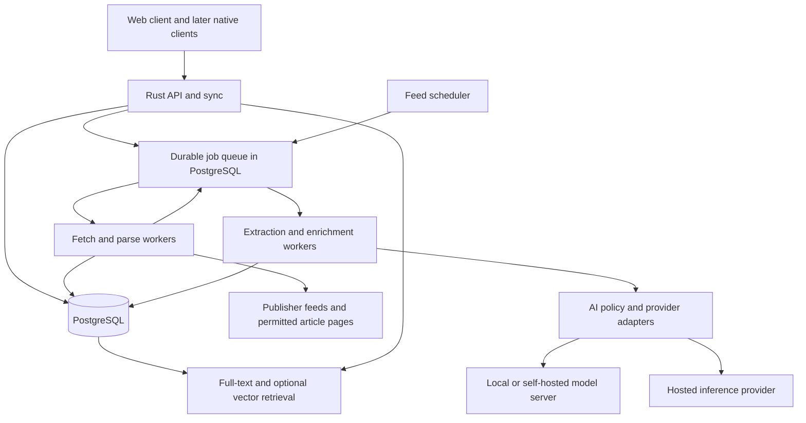

# RSS Platform: Client, Aggregation Backend, AI, and Development Plan

Date: 2026-10-21  
Status: Initial proposal; implementation has not started.  
Research baseline: Official product pages, project documentation, and model cards reviewed on the date above. Product capabilities and model availability can change.

## 1. Recommendation

Build a reader that helps people understand what changed across their chosen sources, with a dependable RSS service underneath it. Prioritize reliable subscriptions, fast reading, portable data, and offline synchronization. Add AI as an optional processing layer with visible evidence, predictable costs, and a choice of deployment.

Use **Rust for the aggregation backend, API, scheduling, and AI orchestration**. Start with a TypeScript web client, PostgreSQL, and a modular backend deployed as an API process and a worker process from the same codebase. Call model servers through HTTP. Avoid making an entirely Rust UI or an embedded inference engine a prerequisite for the first release.

The most promising product differentiator is **a briefing of new developments since the reader last caught up**, with source links and an explanation of why each development appears. Summaries, chat, and semantic filtering are already available in established products; they are useful baseline features, but insufficient positioning by themselves.

Assumptions for this proposal:

- Initial audience: individual researchers, developers, and people following specialist topics.
- First client: responsive web app with installable PWA support; native applications follow evidence of demand.
- Initial deployment: a small hosted pilot plus a documented self-hosted deployment using the same backend.
- AI is optional. Reading, subscriptions, synchronization, and keyword search work without it.
- Initial language focus: English, while preserving Unicode and original languages throughout storage. Multilingual quality is a separately tested expansion.
- Timeline estimates assume two full-time engineers, at least one comfortable with Rust, and part-time product/design support. These are planning estimates, not delivery commitments.

## 2. Current products and opportunities

The table describes selected documented capabilities. Proposed improvements are product hypotheses, not claims that every competitor lacks them.

| Reference product | Documented capabilities | Implication for this project |
| --- | --- | --- |
| Feedly | Concept-based AI feeds, prioritization, deduplication, muting, and summarization. | Topic filtering and summaries alone will not distinguish a new reader. Make the reasons for grouping and ranking inspectable. |
| Inoreader | Article summaries and questions, entity mentions, reports over collections, and provider choice including bring-your-own-key options on eligible plans. | Model choice and AI reports are already part of the market. Compete on workflow, evidence quality, and transparent budgets. |
| Reeder | A unified timeline, synchronized reading position, filters, and public feeds derived from tags. | Offer a calm catch-up experience and intentional sharing alongside conventional unread counts. |
| Miniflux | Self-hosting, OPML portability, full-text search, content extraction, privacy features, and APIs compatible with existing clients. | Reliable basics and portability are prerequisites. A polished client should work with a well-documented backend. |

Sources: [Feedly capabilities](https://docs.feedly.com/article/523-getting-started-with-feedly), [Inoreader Intelligence](https://www.inoreader.com/features/intelligence), [Reeder](https://www.reederapp.com/), and [Miniflux features](https://miniflux.app/features.html).

### Proposed differentiators

| Feature | Reader benefit | Implementation approach | Priority |
| --- | --- | --- | --- |
| “What changed?” briefing | Avoid reading repeated coverage of the same event. | Versioned story groups, a per-user catch-up checkpoint, and summaries of newly supported developments. | First differentiated beta |
| Evidence-linked summaries | Check a claim without searching through an entire article. | Store article version IDs, paragraph references, and supporting excerpts with each claim. | AI beta |
| Reversible story grouping | Collapse repetition while keeping distinct reporting accessible. | Exact deduplication followed by conservative similarity grouping; expose all sources and allow splitting. | Beta |
| Explainable relevance | Understand why an item was recommended. | Display matched rules or interests and allow immediate adjustment. | Beta |
| Reading-time budget | Catch up in five, fifteen, or thirty minutes. | Estimate reading time and choose a diverse set of developments within the budget. | Later beta |
| Feed health panel | Distinguish a quiet source from a broken subscription. | Show last successful fetch, errors, retry time, and recovery actions. | MVP |
| Local or hosted AI policy | Choose where article content is processed. | Enforce account and source policies before dispatching jobs. | AI beta |
| Complete data export | Move subscriptions and reading history without losing personal work. | OPML for subscriptions; versioned JSON for state, annotations, and settings. | MVP state export; annotations later |

Validate these ideas with 8–12 prospective users who already read many feeds. Ask them to complete the same catch-up task in their current reader and a prototype. Measure useful developments found, time spent, missed important items, and trust in the output. Avoid optimizing for time spent in the app.

## 3. Client experience and release scope

### MVP reader

The primary flow is: import subscriptions → open a chronological inbox → read or save an article → continue on another device.

- Subscribe by feed URL or discover feed links from a website URL.
- Import and export OPML with progress, duplicate handling, and per-feed errors.
- Support folders, unread/read state, stars, saved searches, and bulk actions with undo where practical.
- Provide an accessible article view with keyboard navigation, adjustable typography, dark mode, and mobile layouts.
- Show source, publication time, ingestion time when relevant, and whether content is a feed excerpt or extracted article text.
- Support keyword search and deterministic filters before introducing semantic search.
- Cache selected articles for offline reading and queue state changes until reconnection.
- Expose feed health, refresh controls subject to rate limits, and clear authentication errors.
- Preserve a chronological view even when recommendations are enabled.

Use three main destinations: **Inbox**, **Saved**, and **Search**. Add **Briefing** when its quality passes the AI evaluation gate. Place source links beside generated claims and show an explicit state when an AI result is unavailable or based only on an excerpt.

### Synchronization contract

Treat synchronization as a product feature with a defined conflict policy:

1. Each client mutation has a unique operation ID and a base server revision.
2. The server acknowledges operations idempotently and returns a new revision.
3. Clients consume a paginated change log using an opaque cursor, including deletion tombstones.
4. Independent fields merge separately. Conflicting changes to the same field use server acceptance order for the MVP; document that a delayed offline action can supersede a newer device action.
5. Bulk “mark read” records a fixed item set or server-side cutoff so newly arriving articles are not unintentionally marked read.
6. Expired cursors trigger a new snapshot while preserving and replaying pending local operations.

Browser storage can be evicted and background execution varies by platform. Describe offline support as access to downloaded content, show cache status, and test storage loss and reconnection. A desktop client can later provide stronger local persistence.

### Scope after MVP

Add highlights, annotations, story groups, AI summaries, semantic search, and briefings in that order as dependencies permit. Consider newsletters, podcast transcripts, shared folders, and source discovery after the core reading loop is useful.

Defer a social network, general web crawler, autonomous research agent, custom foundation-model training, and simultaneous native launches across every platform. Each would materially increase the initial development and operating burden.

## 4. Backend architecture

Use a modular monolith with durable asynchronous jobs. Keep module boundaries explicit without introducing independent services for every responsibility.



The diagram shows logical responsibilities. The API and workers can share a repository and container image. Start with PostgreSQL for metadata, jobs, full-text search, and optional vectors; add object storage for larger retained payloads when measured storage requirements justify it.

### Feed ingestion

1. **Discover:** Accept HTTP(S) feed URLs and inspect HTML feed links when a website URL is supplied. Validate every fetched destination, including redirects.
2. **Schedule:** Track next fetch time, failure count, average publication frequency, and publisher hints. Apply global and per-host concurrency limits with jitter.
3. **Fetch:** Reuse HTTP connections and issue conditional requests using ETag and Last-Modified when supplied. Respect Retry-After and distinguish temporary failures from persistent failures.
4. **Parse:** Normalize RSS, Atom, and JSON Feed into a shared internal representation, preserving useful original metadata and parse diagnostics.
5. **Identify:** Prefer a feed-scoped stable item ID, then conservative URL and content-based fallbacks. Never assume GUIDs are globally unique.
6. **Version:** Detect meaningful content changes separately from repeated delivery. Preserve versions needed by citations and update dependent AI artifacts when content changes.
7. **Persist:** Commit items and downstream jobs atomically so a worker crash cannot leave enrichment permanently unscheduled.
8. **Enrich:** Extract readable content where available, sanitize HTML, identify language, index text, and enqueue optional AI work.
9. **Notify:** Append relevant account changes to the synchronization stream. AI completion is a separate event from article arrival.

The [feed-rs documentation](https://docs.rs/feed-rs/latest/feed_rs/) describes a unified parser for RSS, Atom, and JSON Feed. Build fixtures from real feeds, including missing dates, unstable IDs, relative URLs, malformed XML, and unusual encodings. Format support does not guarantee success on every publisher feed. JSON Feed details are defined in the [version 1.1 specification](https://www.jsonfeed.org/version/1.1/).

Add WebSub after polling is dependable. It can deliver updates through hubs; keep polling as recovery for missed deliveries and unavailable subscriptions. Validate subscriptions, authenticate deliveries where supported, and manage lease renewal. See the [WebSub specification](https://www.w3.org/TR/websub/).

### Durable execution and failure recovery

Use leased jobs with attempts, next-attempt time, lease expiry, and a terminal failure state. Workers reclaim expired leases and renew long-running work. Delivery is at least once; business operations must be idempotent.

Partition concurrency budgets between fetching, extraction, embeddings, and generation. An AI backlog must not prevent ordinary feeds from updating. Add exponential backoff with jitter, per-provider circuit breaking, and user-visible retry controls. Track oldest queued job age as well as queue length.

For the initial queue, short PostgreSQL transactions can claim available jobs using row locks and `SKIP LOCKED`; release the transaction before making network requests. Benchmark queue contention before adding a separate broker.

### Data model

| Entity | Important fields and responsibilities |
| --- | --- |
| Account and device | Identity, sessions, preferences, device IDs, AI policy, spending limit |
| Feed | URL, access scope, fetch validators, schedule, health, credentials reference |
| Subscription | Account/feed relationship, folder, title override, filters |
| Item | Feed-scoped external ID, URL, author, publication and ingestion timestamps |
| Item version | Content hash, sanitized HTML, extracted text, extraction status and provenance |
| User item state | Account/item relationship, read/star/save state, revision |
| Annotation | Account, item version, text anchor, highlight or note |
| Story and membership | Related items, grouping evidence, algorithm version, manual corrections |
| Chunk and embedding | Item version, paragraph offsets, model revision, vector dimensions |
| AI artifact | Task, input versions, output, evidence references, prompt/model version, scope |
| Job and usage ledger | Idempotency key, lease, attempts, usage reservation, billed usage |
| Change event | Account, revision, changed entity, tombstone, operation ID |

Fetch and store public feeds once where appropriate, while keeping each user's state separate. Credentialed feeds, private URLs, personal notes, and personalized outputs require explicit access scopes. Do not share their cached artifacts across accounts. Scrub token-bearing feed URLs from logs.

### API shape

Start with versioned JSON REST endpoints and cursor pagination. Examples describe intended contracts, not implemented routes:

| Endpoint | Purpose |
| --- | --- |
| `POST /v1/subscriptions` | Discover or subscribe to a feed asynchronously |
| `POST /v1/imports/opml` | Start an import and return a progress resource |
| `GET /v1/items?cursor=...` | Retrieve an authorized, filtered article page |
| `POST /v1/state-operations` | Apply idempotent read/save/star operations |
| `GET /v1/sync?cursor=...` | Retrieve changes and deletions |
| `GET /v1/search?q=...` | Keyword or hybrid search within accessible items |
| `POST /v1/ai/jobs` | Request an allowed AI operation with a spending reservation |
| `GET /v1/ai/jobs/{id}` | Retrieve status, output, evidence, and usage |
| `GET /v1/exports/{id}` | Download a scoped data export |

Add server-sent events for completion notifications if useful; the durable sync API remains the source of truth. Document authorization, rate limits, and errors. Evaluate one existing reader compatibility API after the native contract stabilizes.

## 5. AI features and model integration

### Use the smallest suitable technique

| Task | Starting technique | When to use a generative model |
| --- | --- | --- |
| Exact duplicates | Feed IDs, conservative URL normalization, content hashes | Usually unnecessary |
| Related story candidates | Time windows, entities, lexical similarity, embeddings | Resolve ambiguous candidates only if evaluation supports the cost |
| Tags and interests | User rules, embeddings, small classifiers | Suggest nuanced tags with user correction |
| Search | Full-text retrieval plus embeddings | Answer questions over retrieved evidence |
| Article summaries | Structured generation over available article text | On request or explicitly enabled rules |
| “What changed?” | Compare new evidence against a versioned story checkpoint | Produce a short cited description of new developments |
| Translation | A translation-capable model evaluated for target languages | On request, retaining the original text |
| Podcast processing | Speech recognition followed by text processing | Summaries only after transcript quality is established |

Do not treat model-generated confidence numbers as calibrated probabilities. Show the available evidence, input completeness, and limitations directly.

### Provider abstraction

Keep an internal interface around tasks rather than around one vendor's request schema. Define typed request and response structures for `embed`, `summarize`, `classify`, and `answer_with_evidence`. Provider adapters translate these to supported APIs.

Record capabilities explicitly: structured output, streaming, embeddings, context limit, token accounting, supported languages, and cancellation. API compatibility does not guarantee identical semantics. Maintain contract tests for each adapter and pin model revisions when the provider allows it.

Suggested execution pipeline:

1. Resolve the task, account, source permissions, and allowed processing locations.
2. Retrieve only authorized input and determine whether it is full text or an excerpt.
3. Calculate an input budget and reserve the estimated maximum spend atomically.
4. Check a scoped cache keyed by content versions, task, model revision, prompt version, language, and relevant settings.
5. Dispatch to an allowed provider with a deadline, output limit, and cancellation handling.
6. Validate the output schema and evidence identifiers; reject references that were not supplied.
7. Store provenance, measured usage, and status; reconcile the reservation and notify the client.

Cache access also requires authorization. Never silently send a local-only task to a cloud provider when local inference fails. Make unavailable results explicit and preserve the reading experience.

### Deployment and model candidates

| Option | Suitable use | Tradeoff |
| --- | --- | --- |
| Hosted inference API | Fastest pilot and access to stronger models without operating GPUs | Usage charges, provider availability, and content processing policy |
| Bring your own key | Users choose a supported provider and account | Secret handling, variable model access, support complexity; provider charges still apply |
| Ollama on the user's server | Personal deployments and local model experiments | Hardware limits and model-specific latency; local mode needs an explicitly local endpoint |
| vLLM on a dedicated inference host | Shared self-hosted inference when demand justifies operation | GPU capacity planning, batching, monitoring, and deployment maintenance |
| Rust inference through Candle | A measured requirement for embedded models or a specialized deployment | Model/kernel compatibility and packaging need separate validation |

[Ollama's API documentation](https://docs.ollama.com/api/introduction) distinguishes local and cloud endpoints. [vLLM's serving documentation](https://docs.vllm.ai/en/latest/serving/online_serving/) provides the starting point for a separately operated inference service. [Candle](https://github.com/huggingface/candle) supports Rust ML workloads and GPU execution, but that does not establish performance for this project's chosen models.

Use **BGE-M3 as one embedding baseline** and **Qwen3-8B as one self-hosted generation baseline** in the first evaluation. These are concrete test candidates, not claims of being the newest or best models. Their publisher model cards document multilingual embeddings and text generation respectively: [BGE-M3](https://huggingface.co/BAAI/bge-m3), [Qwen3-8B](https://huggingface.co/Qwen/Qwen3-8B). Compare them with an available hosted model and a smaller local candidate using the same corpus. Check exact model licenses, revisions, runtime support, and quantization quality before distribution.

For rough hardware intuition, eight billion parameters at four bits require about 4 GB for weights alone in decimal units. Runtime buffers, quantization metadata, KV cache, context length, and concurrency add memory. Do not infer total RAM/VRAM needs or tokens per second from parameter count; benchmark the intended deployment.

### Search and evidence-grounded answers

Use PostgreSQL full-text search for lexical matches and pgvector for semantic candidates. Fuse ranked results, optionally rerank a small candidate set, and pass only relevant passages to generation. Apply access controls in retrieval and again before assembling the prompt.

Each generated answer should contain claims with article version IDs and paragraph references. Validate that cited passages exist; separately evaluate whether they actually support the claims. Valid citation IDs alone do not establish factual support. If the material cannot answer the question, return an insufficient-evidence response.

Approximate vector search can lose recall when filters discard candidates. Test with realistic account/source filters; use exact search for small subsets and tune indexing as the dataset grows. The [pgvector documentation](https://github.com/pgvector/pgvector#filtering) describes this filtering behavior and available strategies.

Changing the embedding model requires versioned vectors and a background reindex. Never compare vectors from incompatible embedding spaces. Switch queries only when the replacement index meets coverage and quality requirements.

### Designing the “What changed?” briefing

Maintain an explicit “caught up through” checkpoint per user and story, separate from simply opening a summary. Select new article versions since that checkpoint, identify candidate new claims, and compare against the previously presented evidence. Generate a briefing only for supported additions or material corrections.

Show publication times, sources, and a link to all coverage. Distinguish multiple independently reported sources from syndicated copies when evidence permits; do not count repeated text as independent corroboration. Preserve disagreements as attributed claims instead of asking a model to declare which source is true.

A user should be able to expand a story, split an incorrect grouping, mute a topic, or mark a briefing caught up. These corrections improve future ranking and provide evaluation data without silently rewriting user subscriptions.

### AI quality and cost controls

Create a versioned evaluation set of roughly 200–500 representative articles and 50–100 questions for the pilot. Include partial text, conflicting reports, long articles, multilingual samples, and adversarial instructions embedded in articles. Keep held-out examples separate from prompt development.

Track factual support per claim, citation correctness, important omissions, duplicate-grouping errors, retrieval relevance, abstention quality, latency, and cost per successful task. Use human review for a sample; automated model judging is supporting evidence, not the only acceptance criterion.

Run a small model/prompt bake-off before selecting defaults. Repeat the held-out evaluation whenever a model, extraction pipeline, prompt, or retrieval strategy changes. Keep rollback versions and use opt-in canaries.

For a monthly estimate:

```text
generation_cost = input_tokens / 1,000,000 * input_price
                + output_tokens / 1,000,000 * output_price

total_AI_cost = generation_cost + embeddings + reranking
              + transcription + retries + inference_host_cost
```

Illustrative workload: 1,000 fresh summary jobs per day, each with 2,000 input tokens and 250 output tokens, consume about 60 million input and 7.5 million output tokens over 30 days, before retries and other tasks. Substitute verified provider prices during procurement. The workload is an assumption, not a traffic forecast or price quote.

Default to on-demand summaries, deduplicate identical permitted work, batch embeddings where supported, and cap per-account background tasks. Report spend and cache savings. A budget reservation must account for simultaneous jobs; a simple after-the-fact counter cannot enforce a hard cap. Reconcile uncertain provider outcomes conservatively because cancellation or retries may still incur charges.

## 6. Rust suitability and stack assessment

### Recommended stack

| Layer | Proposed choice | Reason and qualification |
| --- | --- | --- |
| Runtime and network concurrency | Tokio | Suitable foundation for asynchronous network workloads; bound concurrency and isolate blocking work. |
| HTTP API | Axum with Tower middleware | Typed request handling and reusable middleware for timeouts, tracing, and limits. |
| Feed and provider HTTP | Reqwest | Connection reuse, async requests, TLS, and redirect policy controls. |
| Feed parser | feed-rs | Shared RSS/Atom/JSON Feed representation; validate real-world tolerance. |
| Persistence | PostgreSQL with SQLx | Explicit SQL and async database access; keep migrations and query checks in CI. |
| Search | PostgreSQL full-text search; optional pgvector | Consolidates initial operations; benchmark before introducing a separate search system. |
| Web client | TypeScript with React, or the team's established UI framework | Practical browser tooling and fast UI iteration; keep API types generated or checked. |
| Later desktop client | Tauri using the web UI | Reuse the UI with a Rust application layer; validate platform integration separately. |
| AI execution | HTTP provider adapters | Separates application reliability from model runtime and GPU dependencies. |

Technical references: [Tokio](https://tokio.rs/tokio/tutorial), [Axum](https://docs.rs/axum/latest/axum/), [Reqwest](https://docs.rs/reqwest/latest/reqwest/), [SQLx](https://docs.rs/sqlx/latest/sqlx/), and [Tauri](https://v2.tauri.app/). Tauri supports desktop and mobile targets; shared code does not remove platform-specific background execution, accessibility, packaging, and app-store work.

### Where Rust fits well

- **Concurrent aggregation:** Async I/O suits many slow network sources, while bounded queues can constrain memory and work in flight.
- **Long-lived services:** Ownership and types help enforce resource handling and valid state transitions. Rust's memory safety model does not require a garbage collector; see the [Rust ownership chapter](https://doc.rust-lang.org/book/ch04-00-understanding-ownership.html).
- **Parsing and normalization:** Explicit error types and enums are useful when handling inconsistent publisher data.
- **Deployment:** Compiled application binaries can simplify service distribution, although database, TLS, platform, and optional model dependencies remain.
- **Shared domain logic:** Parsing, filtering, and sync-related logic can potentially be reused in desktop clients where it reduces duplicated behavior.

These are suitability judgments, not measured performance results. Network delays, extraction quality, database access, and inference may dominate total latency. Rust will not by itself make a model generate faster or fix an inefficient database design.

### Costs and limitations

Rust introduces learning costs around ownership, async lifetimes, traits, and error handling. Compilation and complex generic errors can slow early iteration. Favor plain data structures, explicit SQL, small modules, and a limited abstraction layer over a generic framework.

CPU-heavy parsing, HTML processing, and inference must not block async executor threads. Use bounded blocking pools or separate workers, then measure resource contention. Dependency and unsafe-code boundaries still matter; memory safety does not prevent authorization bugs, malicious URLs, or incorrect synchronization.

For this project, prefer web technologies for the first UI and a separate model runtime for inference. Evaluate Rust UI frameworks or embedded inference only against a concrete requirement and a prototype. Training or fine-tuning models is a separate effort with dataset and evaluation requirements.

### Alternatives and decision gate

| Backend choice | Good reason to choose it | Main consideration for this project |
| --- | --- | --- |
| Rust | Team has experience and values a typed, resource-controlled long-running backend | Higher initial learning and implementation overhead for an inexperienced team |
| Go | Team wants a straightforward service implementation and already knows Go | Strong alternative for I/O-heavy aggregation; Rust must justify its additional complexity |
| TypeScript/Node.js | Team wants one language across the first client and API | Move CPU-heavy work away from request processing and measure runtime/resource behavior |
| Python | Team's principal uncertainty is ML experimentation | Keep ingestion reliability and inference deployment explicit rather than assuming one process fits everything |

Run a two-week Rust feasibility slice: subscribe to real feeds, persist normalized items, serve a paginated inbox, and invoke one model endpoint. Measure implementation time, memory, scheduling lag, build feedback time, and operational clarity. Continue with Rust if this slice is maintainable by the actual team. If language learning dominates progress, changing the backend language early is cheaper than carrying an unreadable implementation into production.

## 7. Reliability, privacy, and operations

RSS aggregation accepts arbitrary external URLs and untrusted documents. Include the following engineering requirements from the first usable backend:

- Prevent server-side request forgery: permit HTTP(S), reject private/loopback/link-local/metadata destinations, validate redirects, and bind connections to validated address resolution to avoid DNS rebinding. Apply equivalent checks to images, extraction URLs, and WebSub destinations.
- Set limits on request time, redirect count, compressed and decompressed body size, XML depth, and parser work. Do not enable external entity resolution.
- Sanitize all publisher HTML, enforce a restrictive content security policy, and restrict embeds and external resource loading. Treat fetched text and generated output as untrusted.
- Keep article content separate from model instructions. Give summarization workers no ambient tools, secrets, or ability to follow instructions inside articles; prompt wording alone is insufficient isolation.
- Enforce authorization for every article, search result, vector candidate, AI artifact, export, and job. Test isolation with multiple accounts and private feeds.
- Store provider keys and feed credentials encrypted with managed application secrets; keep them out of logs and browser persistence.
- Use authenticated sessions, CSRF protection where relevant, login throttling, and an established identity integration where practical.
- Make retention and deletion explicit for articles, embeddings, AI outputs, logs, and backups. Deleting an account must also revoke credentials and stop queued work.
- Use source-provided text when full content is unavailable; label excerpts. Do not design extraction around defeating access controls. Decide retention and sharing policies before public deployment.

Collect structured logs, request traces, feed error rates, scheduling lag, queue age, extraction success, database latency, provider failures, and per-task usage. Redact private URLs, tokens, and article text by default.

Use separate development, staging, and production data. Automate database backups and rehearse restores. Prefer backward-compatible schema changes so an application rollback does not require immediately reversing a destructive migration. Document feed outages, provider failures, credential rotation, and disk exhaustion recovery.

### Initial capacity model and targets

Use a reference dataset of 10,000 public feeds and one million retained items for an initial load exercise. At a uniform 30-minute polling interval, 10,000 feeds imply approximately 480,000 requests per day, averaging 5.6 requests per second before article extraction and retries. Real load is bursty and concentrated by publisher, so host fairness matters more than that average alone.

Storage planning must include article text, versions, search indexes, embeddings, and backups. For example, one million items averaging 20 KB of retained text imply about 20 GB of text alone. These are illustrative assumptions; measure actual distributions before selecting infrastructure.

Candidate release targets, to be revised after the feasibility slice:

| Measure | Initial target and measurement condition |
| --- | --- |
| Inbox API | p95 below 300 ms at 25 concurrent active users on a documented reference deployment; excludes internet transit |
| Feed freshness | 95% of successful fetch jobs begin within five minutes of their scheduled time; publisher failures reported separately |
| Synchronization | No lost acknowledged mutations in crash/retry/offline scenario tests |
| Availability | Proposed 99.5% monthly service objective for the pilot, measured separately from publisher availability |
| AI evidence | At least 95% of sampled generated factual claims supported by cited input on the held-out set; report sample size and uncertainty |
| Story grouping | At least 95% precision on labeled grouping decisions, with coverage reported to prevent a trivial no-grouping result |
| Account isolation | Zero cross-account disclosures in the defined adversarial integration suite |

These are proposed acceptance thresholds, not benchmark results or guarantees. AI precision thresholds require a human labeling rubric and do not imply perfect factual reliability.

## 8. Development cycles and delivery plan

Use two-week cycles with a working demonstration, a small user feedback session, and an updated risk log. The first useful reader is more valuable than a wide set of unfinished AI features.

### Roadmap for the assumed two-engineer team

| Cycle | Elapsed weeks | Deliverable | Exit criteria |
| --- | --- | --- | --- |
| 0: Feasibility and discovery | 1–2 | User interviews, representative feed corpus, Rust slice, basic model comparison | Subscribe → fetch → persist → view works; major stack risks and initial measurements recorded |
| 1: Reliable ingestion | 3–4 | Scheduling, conditional fetches, bounded parsing, retries, feed health | Restart and duplicate-delivery tests pass; malformed and inaccessible sources do not stall workers |
| 2: Core reader | 5–6 | Accounts, subscriptions, OPML, folders, read/save state, accessible reading view | A pilot user can import subscriptions and complete the daily reading flow |
| 3: Search and offline sync | 7–8 | Keyword search, offline cache, change stream, export, basic deployment | Two devices converge under documented conflict rules; restore drill and account isolation tests pass |
| 4: AI foundation | 9–10 | Provider policies, usage ledger, one hosted adapter and one local adapter, cited summaries | Held-out summary gate passes; model outages and exhausted budgets leave core reading usable |
| 5: Retrieval and story groups | 11–12 | Embeddings, hybrid retrieval, conservative grouping, correction controls | Retrieval improves on keyword baseline for target tasks; grouping precision gate passes |
| 6: Differentiated briefing | 13–14 | “What changed?”, catch-up checkpoints, reading-time preferences | User task study shows useful reduction in repeated reading without unacceptable omissions |
| 7: Beta hardening | 15–16 | Accessibility review, load exercise, recovery drills, onboarding and operating documentation | Reference targets measured; major reliability defects resolved; scope accepted for beta |

This suggests a **core reader pilot in roughly 6–8 weeks** and an **AI-enabled beta in roughly 14–16 weeks**, before contingency. Reserve an additional 20–30% for unfamiliar feeds, extraction failures, sync edge cases, and user feedback. Do not add that reserve by silently removing acceptance criteria.

For a solo engineer, a reasonable preliminary planning range is 3–5 months for the core reader and 6–9 months for the fuller beta, depending strongly on Rust and frontend experience. Re-estimate after cycle 0. Native applications, broad multilingual support, billing, team workspaces, and high-availability operation require separate estimates.

### Rhythm within each cycle

1. Define a small user outcome and its acceptance criteria; resolve unknowns with short prototypes.
2. Implement a vertical slice across backend and client where possible.
3. Test failure behavior as well as the happy path; update operating notes alongside the change.
4. Demonstrate with real feeds and representative users, then record what changed in the next cycle's priorities.
5. Keep unfinished experiments behind feature flags and preserve a deployable main branch.

For Rust changes, run formatting, linting, focused unit tests, and database-backed integration tests in CI. Use parser fixtures and fuzzing for untrusted input, scenario tests for synchronization, and a small browser suite for import/read/save/offline flows. Add load tests when scheduling or query behavior changes. AI changes need dataset evaluations in addition to conventional tests.

### Dependencies and scope controls

AI citations depend on stable article versions and extraction provenance. Briefings depend on story membership and user checkpoints. Offline reading depends on a durable state protocol. Establish these dependencies before parallel implementation creates incompatible assumptions.

Keep explicit work budgets for operational fixes and usability. If a cycle overruns, defer optional features such as translation or advanced ranking before weakening ingestion, synchronization, or authorization. Revisit the roadmap after every two cycles using measured delivery speed.

## 9. Decisions to validate before implementation expands

| Decision | Proposed default | Evidence that could change it |
| --- | --- | --- |
| Initial audience | Individual specialist readers | Interviews reveal a stronger shared research workflow |
| Client platform | Web/PWA first | Pilot users require durable device storage or native integrations immediately |
| Backend language | Rust | Feasibility slice shows unacceptable delivery cost for the actual team |
| Database and queue | PostgreSQL for both | Measured queue contention or search workload justifies separation |
| AI policy | Optional; per-account and per-source controls | User requirements demand a strictly local-only product |
| First AI feature | Cited on-demand summaries | User studies show search or grouping solves a more urgent task |
| Main differentiator | Evidence-linked updates since last catch-up | Briefings omit important information or fail to save useful effort |
| Deployment | Hosted pilot and one documented self-hosted path | Support burden requires focusing on one deployment initially |
| Business model | Evaluate paid hosting with metered AI allowances | Usage economics and willingness-to-pay data favor another approach |

The next concrete development task is cycle 0: validate the reading workflow and build the smallest complete aggregation slice. Use its measurements to approve the stack and narrow the first release before expanding AI scope.
